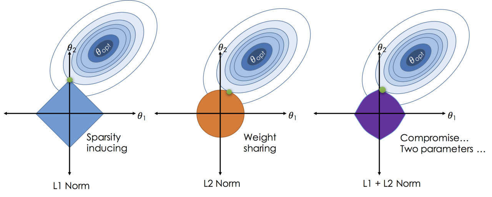

## Table of Contents
- Q1. L1 정규화 vs L2 정규화
- Q2. L1 정규화에서의 미분불가능
- Q3. Adam Optimizer

## Q1. L1 정규화 vs L2 정규화

다음 두 정규화 항(regularization term)이 있습니다:

$$\mathcal{L}_{\text{L1}} = \mathcal{L}_{\text{task}} + \lambda \sum_i |w_i|$$

$$\mathcal{L}_{\text{L2}} = \mathcal{L}_{\text{task}} + \lambda \sum_i w_i^2$$

1. L1과 L2 정규화가 가중치(weight)에 미치는 효과의 **핵심적인 차이**는 무엇인가요?
2. L1 정규화가 **희소(sparse)한 가중치**를 만들어내는 이유를 수식 또는 기하학적 관점에서 설명하세요.

### Answer 1.
1. 두 개의 Loss를 미분해보면, 아래와 같다.
    $$\nabla\mathcal{L}_{\text{L1}} = \nabla\mathcal{L}_{\text{task}} + \lambda\cdot\text{sign}(w_i)$$
    $$\nabla\mathcal{L}_{\text{L2}} = \nabla\mathcal{L}_{\text{task}} + 2\lambda w_i$$
    L1 정규화는 가중치 크기와 무관한 상수($\lambda$)만큼 Gradient에 기여하고, L2 정규화는 가중치 크기에 비례해서($2\lambda w_i$) Gradient에 기여한다.
        
2. 정규화는 각 가중치의 제약 영역을 설정하는 것과 같다고 볼 수 있다.
    
    즉 정규화는 위와 같은 제약 영역을 설정해서, Bias에 손해를 보더라고 Variance를 감소(=Underfitting)시키게 되며, 해당 제약을 추가한 Loss function의 최적값은 Global optimum과 제일 가까운 지점이 된다.

    그림과 같이, L1 정규화에서는 최적값에 근사하는 지점에 꼭짓점이 존재한다. 꼭짓점에서는 특정 가중치가 정확히 0임을 의미하므로, 의미가 적은 특정 변수를 삭제하여 Sparse한 가중치를 만들어 낸다. (Feature Selection)

    L2 정규화는 이상치에 더 민감하게 반응하게 되므로, 모델의 전체적인 복잡성을 감소시키는 역할을 한다.

## Q2. L1 정규화에서의 미분불가능
L1 정규화에서, $w_i = 0$ 일 때 $|w_i|$는 미분 불가능합니다.

**두 가지를 답하세요:**

1. $w = 0$ 지점에서 gradient descent를 어떻게 적용할 수 있나요?
2. $w$가 아주 작은 양수 $\epsilon$에 가까울 때, L1과 L2 각각의 gradient 기여 크기를 수식으로 비교하여, **L1만이 가중치를 정확히 0으로 만들 수 있는 이유**를 설명하세요.

### Answer 2.
1. 미분 불가능한 지점에서는, Subgradient를 사용할 수 있다. 
    Subgradient란, 미분값이 될 수 있는 값들의 집합(Subdifferential)에서 임의의 한 값을 선택하는 방식이다. $f(w)$의 $w_0$에서의 Subgradient $g$는:
    $$f(w) \ge f(w_0)+g\cdot(w-w_0) \quad \forall w$$
    를 만족하는 모든 $g$의 집합이다.

    L1 정규화의 경우, $w = 0$에서 미분 불가능하지만, 아래와 같이 $w = 0$에서의 Subgradient를 사용할 수 있다.

    $$∂|w_i​|∣_{​w_i​=0}​=g, \quad g∈[−1,1]$$

2. $w = \epsilon$이라면, L1 정규화: $\lambda \cdot \text{sign}(\epsilon) \rightarrow \lambda$으로 $\epsilon$과 무관한 상수값이고, L2 정규화: $2\lambda\epsilon\rightarrow 0$으로 점점 사라지게 된다.

    이때, Task Loss의 그래디언트($\mathcal{L}_\text{task}$)가 $\lambda$보다 작다면, Subgradient가 $w=0$을 유지시키려고 한다.
    

## Q3. Adam Optimizer
**Adam 옵티마이저**는 다음과 같이 파라미터를 업데이트합니다:

$$m_t = \beta_1 m_{t-1} + (1 - \beta_1) g_t$$

$$v_t = \beta_2 v_{t-1} + (1 - \beta_2) g_t^2$$

$$\hat{m}_t = \frac{m_t}{1 - \beta_1^t}, \quad \hat{v}_t = \frac{v_t}{1 - \beta_2^t}$$

$$w_t = w_{t-1} - \frac{\eta}{\sqrt{\hat{v}_t} + \epsilon} \hat{m}_t$$

$$\beta_1, \beta_2 = \text{const}, \; g_t=\nabla_w\mathcal{L}(w_{t-1};B_t)$$

**두 가지를 답하세요:**

1. $m_t$와 $v_t$는 각각 무엇을 추정하며, 왜 $\hat{m}_t$, $\hat{v}_t$로 **bias correction**이 필요한가요?
2. vanilla SGD와 비교했을 때, Adam이 **학습 초반에 특히 유리한 이유**는 무엇인가요?

### Answer 3.
1. $m_t$는 그래디언트의 지수이동평균(=1차 모멘트)이고, $v_t$는 그래디언트 제곱의 지수이동평균(=2차 모멘트)이다.

    1차 모멘트란, Momentum과 동일한 개념으로, 단순 평균이 아니라 최근 기울기에 더 많은 가중치를 주는 방식이다. 즉, 파라미터가 진동하지 않고 일관된 방향으로 나가도록 도와준다.

    2차 모멘트란, RMSProp에서 유래된 개념으로, 학습률을 기울기의 분산에 따라 조정할 수 있도록 돕는다. 즉, 기울기의 크기에 따라서 학습률을 자동으로 조정해주는 역할을 한다.

    초기 학습시, $m_0, v_0$를 $0$으로 초기화하기 때문에, 초기에는 $m_t, v_t$가 실제 값보다 $0$쪽으로 편향되게 된다. 이를 보정하기 위해 Bias Correction이 필요하게 된다.

2. SGD는 현재 Timestep의 그래디언트만으로 가중치 변화를 결정하므로 비효율적인 움직임으로 수렴하게 된다. 그러나 Adam은 $\hat m_t$를 이용해 이전 Timestep들의 결과를 보고 현재 시점에서 가중치의 이동을 결정하게 되므로 더욱 빠르게 수렴에 도달할 수 있다.

    또한, SGD는 모든 가중치에 동일한 크기의 학습률을 이용해서 학습하게 된다. 그러나, Adam은 $\hat v_t$를 이용해서 가중치별 학습률을 다르게 한다. 그래디언트가 큰 가중치는 학습률을 자동으로 줄여 발산을 막고, 그래디언트가 작은 가중치는 학습률을 자동으로 키워 느린 수렴을 방지하게 된다.

## Extra Question
- 실제로 L1 정규화는 가중치를 0으로 만드는가?
    - Task Loss의 존재, 일정한 상수 $\lambda$의 연산으로 인해서 정확히 0으로 수렴하지 않거나 0 근처에서 진동하는 문제가 존재할 수 있음
    - 따라서 Soft-Thresholding이라는 기법을 사용함
        $$S_{\eta\lambda}(w')=\text{sign}(w')\cdot\max(|w'|-\eta\lambda, 0) \\
        w' = w-\eta\nabla\mathcal{L}_{\text{task}}
        $$
        - 즉, $|w'|\le\eta\lambda$이면 $S_{\eta\lambda}(w')=0$으로 Clipping하므로 위와 같은 문제점이 사라진다.
