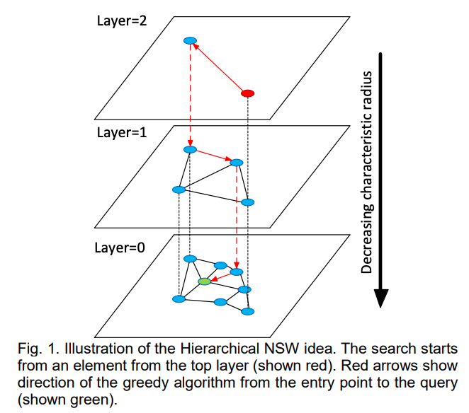

## Table of Contents
- Q1. HNSW 계층구조와 greedy 탐색
- Q2. M과 ef_construction의 Trade-off
- Q3. HNSW vs IVF-PQ

## Q1. HNSW 계층구조와 greedy 탐색

**HNSW(Hierarchical Navigable Small World)**는 벡터 데이터베이스에서 ANN 검색에 널리 사용되는 그래프 기반 인덱스입니다.

탐색 시 레이어를 내려가는 greedy search의 과정을 서술하고, HNSW의 계층(layer) 구조가 탐색 속도를 어떻게 높이는지 직관적으로 설명하세요. 또한 HNSW 전체 탐색의 시간 복잡도를 수식으로 표현하세요. (레이어 수와 전체 노드 수를 활용해서 설명하세요.)

### Answer 1.

1. 현재 레이어에서 Query와 가장 가까운 노드로 이동하고, 한 레이어씩 내려가면서 Query에 가장 가까운 노드로 이동하는 것을 반복함으로써 최종 K개를 뽑는다. 이때, 상위 레이어에는 노드가 매우 적어서 장거리를 한 번에 크게 이동할 수 있고, 하위 레이어로 갈수록 노드가 많아서(맨 아래 레이어는 전체 노드) 정밀하게 탐색할 수 있다. 즉, 넓은 그래프에서 빠르게 방향을 잡고 하위 레이어에서 정밀하게 좁혀가는 방식으로 속도를 높일 수 있다.

> Greedy Search 과정
> 1. 최상위 레이어에서 임의의 entry point에서 시작
> 2. 현재 레이어에서 Query에 가장 가까운 이웃으로 Greedy하게 이동
> 3. 더 이상 가까운 이웃이 없으면 한 레이어 아래로 내려감
> 4. 레이어 0에 도달할 때까지 반복, K-NN 집합 반환

전체 노드 수가 N이라고 하면, 레이어의 수는 log N으로 결정한다. 즉, 레이어 0(최하위 레이어)에는 모든 N개 노드가 있고, 최상위 레이어에는 O(log N)개의 노드만 존재한다. 각 레이어에서의 탐색 비용이 O(log N)이고 레이어 수가 O(log N)이므로, 전체 시간복잡도는 O(log^2 N)이 된다.

## Q2. M과 ef_construction의 Trade-off

HNSW에는 두 가지 핵심 하이퍼파라미터가 있습니다.

**두 가지를 답하세요:**

1. **M (최대 연결 수)** — M이 크면/작으면 검색 품질과 메모리 사용량이 어떻게 달라지는지 설명하세요.

$$\text{메모리} \propto M \cdot n \cdot d_{\text{vector}}$$

2. **ef_construction (탐색 후보 크기)** — 인덱스 구축 시 ef_construction이 크면/작으면 인덱스 품질과 구축 시간이 어떻게 달라지는지 설명하세요.

> 힌트: M과 ef_construction은 검색 품질(recall)과 연산 비용 간의 trade-off를 조절합니다.

### Answer 2.

M과 ef_construction이 커질수록 Recall 증가, 메모리 사용량 증가, 빌드 시간이 증가하는 trade-off가 있다. 즉, 두 파라미터 모두 커지면 검색/인덱스 구축 품질이 커지지만 시간/메모리적으로 손해를 보게 된다.

## Q3. HNSW vs IVF-PQ

벡터 DB에서 HNSW 외에 **IVF-PQ(Inverted File Index + Product Quantization)**도 널리 사용됩니다.

**두 가지를 답하세요:**

1. **IVF-PQ의 구조** — IVF(클러스터 기반 분할)와 PQ(벡터 압축)가 각각 어떻게 동작하는지 설명하세요.

$$\text{IVF: } x \approx c_k + r, \quad \text{PQ: } r \approx [q_1(r_1), q_2(r_2), \ldots, q_m(r_m)]$$

2. **HNSW vs IVF-PQ 비교** — 인덱스 구조, 검색 속도, 메모리 효율, 검색 품질(recall) 측면에서 두 방법을 비교하고, 어떤 상황에서 각각을 선택하는지 설명하세요.

### Answer 3.

1. IVF(Inverted File Index)는 K-Means로 벡터 공간을 K개의 클러스터로 나눈 뒤, 역색인을 구성한다. Query에 대해 가장 가까운 n개의 클러스터를 선택해 그 내에서만 탐색하는 방법이다. 전체 N개를 보는 대신에 일부 클러스터만 보게 되므로 속도가 빠르다.

> 역색인(Inverted Index): 키워드를 통해 문서를 찾아내는 방식
> e.g. 책 뒤편 키워드 목록을 통해서 역으로 본문을 찾는 방식

PQ(Product Quantization)은 벡터를 작은 조각(sub-vector)로 쪼개서 압축하는 기법이다. 차원이 d인 벡터를 m개의 sub-vector로 분할하고 각 sub-vector를 인덱스로 치환한다. 따라서 압출률과 메모리 효율이 높아진다. 

2. HNSW는 검색 속도가 빠르고, Recall이 높지만, 원본 벡터를 그대로 저장하므로 메모리가 많이 필요하게 된다. 반면 IVF-PQ는 검색 속도가 빠르고, 메모리가 적게 필요하지만, 벡터를 압축하므로 정보 손실이 발생할 가능성이 있어 Recall이 낮을 수 있다.

따라서 HNSW는 수백만 건 이하 데이터와 Recall이 중요한 경우. 즉, 의료/법률/고품질의 RAG 상황에서 사용할 수 있다. IVF-PQ는 대규모 검색 서비스와 같이 수억 건 이상의 데이터 상황에서 사용할 수 있다. FAISS 등에서는 HNSW + PQ의 혼합 방식을 사용하기도 한다.