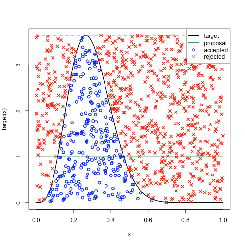

## Table of Contents
- Q1. Speculative Decoding의 동작 원리 (병목·수락 조건·기대 효과)
- Q2. 출력 분포 보존과 거부 시 보정 샘플링
- Q3. 속도 향상의 이론적 상한과 한계

## Q1. Speculative Decoding의 동작 원리 (병목·수락 조건·기대 효과)

LLM 추론에서 Speculative Decoding의 동작 원리를 설명하세요. 구체적으로 다음을 포함해 답하세요: 왜 필요한가?(일반 autoregressive 디코딩의 어떤 병목을 해결하는가) / 어떻게 동작하는가?(Draft model과 Target model의 역할, 토큰 수락(accept) 조건) / 기대 효과(이론적 속도 향상과 그 한계).

### Answer 1.

일반적인 autoregressive 디코딩은 다음 토큰을 생성하기 위해서 이전 토큰을 반드시 생성해야 한다. 즉, 병렬적으로 토큰을 생성할 수 없고 순차적으로 생성해야 한다. 또한 토큰 1개를 생성할 때마다 모델 전체 parameter를 메모리에서 읽어야 하는데, 연산량(FLOPs)은 그에 비해 매우 작아서 GPU 연산 유닛이 거의 비어있게 된다(memory-bound).

Speculative Decoding은 이러한 병목을 해결하기 위해서 사용된다. 작은 크기의 Draft model이 특정 구간의 토큰을 생성하고, Target 모델은 각 draft 토큰 $x$에 대해서 확률적 수락 테스트를 수행한다. draft가 $q$에서 토큰 $x$를 뽑았을 때, target 분포 $p$에 대해 **$\min\!\big(1, p(x)/q(x)\big)$** 확률로 수락한다. accept된 토큰은 그대로 사용하다가, reject된 토큰 시점부터 target model로 다시 생성한다. draft가 생성한 토큰 전체를 target model이 1번의 forward pass로 병렬 검증하므로(teacher-forcing처럼 동시 처리), autoregressive decoding보다 속도 향상이 일어난다. 반면 첫 토큰이 reject되면 일반 autoregressive와 동일한 생성 과정을 거치게 된다.

## Q2. 출력 분포 보존과 거부 시 보정 샘플링

Speculative Decoding은 작은 draft model을 쓰는데도 최종 출력 분포가 target model 단독으로 생성한 것과 "정확히 동일"하다고 합니다. 이것이 어떻게 보장되는지, 특히 draft 토큰이 거부(reject)됐을 때 무엇을 하는지 설명해보세요.

### Answer 2.

Draft 토큰이 reject 되었을 때, 다음 토큰은 정규화된 residual 분포에서 resampling을 수행한다. 

$$
p_\text{resid}(x) = \frac{\max(0, p(x)-q(x))}{\sum_{x'} \max(0, p(x')-q(x'))}
$$

즉, accept-reject 규칙이 **rejection sampling**과 같아, 결과적으로 target 분포 $p$에서 뽑은 것과 통계적으로 동일한 샘플링이 이루어진다. draft가 $x\sim q$를 제안하면 $\min(1, p(x)/q(x))$로 수락한다. 거부되면 그 토큰을 버리고, 잔차 분포에서 다시 샘플링하게 된다. accept와 reject 경로를 합치면 최종 분포가 정확하게 $p$가 된다. 따라서 "근사"가 아니라 정확한 "일치"가 된다.

즉, draft 모델의 품질은 문장 생성에 영향을 끼치지 않고, 수락률(속도)에만 영향을 미치게 된다. draft 모델이 좋지 않아도 결과는 항상 target과 동일하지만 생성 속도가 느려질 뿐이다.

> - **흔히 놓치는 지점:** "작은 모델을 썼으니 품질이 조금 떨어질 것"이라는 오해. 품질은 target과 동일하고, draft 품질은 오직 "속도"(수락률)에만 영향을 준다. draft가 나빠도 결과는 옳고 단지 느려질 뿐이다.
> - **한 단계 더:** 잔차 분포 $(p-q)_+$의 유도, greedy(argmax) 검증과의 차이, 그리고 temperature/top-p 같은 샘플링 세팅에서도 분포 보존이 성립하도록 구현하는 방법을 언급하면 좋다.

## Q3. 속도 향상의 이론적 상한과 한계

각 draft 토큰이 i.i.d.로 확률 $\alpha$만큼 수락된다고 근사하고, draft model이 한 번에 $\gamma$개의 토큰을 생성한다고 합시다. Target model의 forward pass 1회 비용을 $1$로, draft model의 forward pass 1회 비용을 $c$ ($c < 1$, 보통 $c \ll 1$)로 정규화하세요.

1. 한 번의 draft+verify 사이클에서 **평균적으로 생성되는 토큰 수**를 $\alpha, \gamma$로 표현하세요. (힌트: target model은 reject 여부와 무관하게 항상 최소 1개 토큰을 보장합니다.)
2. 사이클당 평균 비용을 $c, \gamma$로 표현하고, 이를 이용해 **이론적 speedup factor**를 수식으로 유도하세요.
3. 이 모델에서 $\gamma \to \infty$로 보내면 speedup이 어떻게 되는지, 그리고 실제로는 왜 $\gamma$를 무한히 키우지 않는지 설명하세요.

### Answer 3.
1. 토큰을 확률 $\alpha$만큼 수락한다고 사면, 생성되는 총 토큰 수는 1부터 $\gamma+1$ 사이의 값을 가진다. 이때, $P(T\ge i) = \alpha^{i-1}$이므로, 사이클 당 평균 생성 토큰 수는 아래와 같다:

$$
E[T] = \sum^\gamma_{i=0}\alpha^i = \frac{1-\alpha^{\gamma+1}}{1-\alpha}
$$

2. 비용은 draft model의 $\gamma$번 forward 연산 + target mode의 검증 forward 1회 연산이 발생한다. 즉, $\text{cost} = \gamma\cdot c + 1$이다.

이때, 일반 decoding은 토큰 1개당 비용 1이 들기 때문에, $E[T]$개 토큰을 생성하는데는 $E[T]$의 비용이 든다. 따라서 speedup factor는 다음과 같다:

$$
\text{SpeedUp} = \frac{E[T]}{\text{cost}} = \frac{1-\alpha^{\gamma+1}}{(1-\alpha)(\gamma c + 1)}
$$

3. $\gamma \to \infty$가 되면 $\alpha \lt 0$이므로 분자는 유한한 값으로 수렴한다. 반면 분모는 $\gamma$에 비례해 선형적으로 증가한다. 따라서 Speedup factor는 $\gamma \to \infty$가 되면 0으로 사라지게 된다.

직관적으로, accept 확률이 1보다 작으면 draft model의 생성이 길어질수록 뒤쪽 토큰이 reject될 가능성이 커져 버려지는 draft 비용이 커지는데, 얻을 수 있는 기대 토큰 수는 유한한 값으로 수렴하기 때문이다. 따라서 draft model의 품질(=$\alpha$)와 draft model의 상대적 비용(=$c$)에 따라서 speedup factor를 최대화하는 최적의 $\gamma$가 존재하며 보통 4~8 정도로 설정한다.

## 오늘의 수식 카드

**수락 확률 (draft $q$ → target $p$)**

$$\text{accept}(x) = \min\!\left(1,\; \frac{p(x)}{q(x)}\right)$$

**거부 시 보정(잔차) 분포**

$$p_{res}(x) = \frac{\max\big(0,\; p(x) - q(x)\big)}{\sum_{x'} \max\big(0,\; p(x') - q(x')\big)}$$

| 기호 | 의미 |
|------|------|
| $q(x)$ | draft(작은) 모델의 토큰 확률 |
| $p(x)$ | target(큰) 모델의 토큰 확률 |
| $\alpha$ | 평균 수락률(분포 겹침 정도) |
| $\gamma$ | 한 번에 제안하는 draft 토큰 수 |

직관: 수락은 target/draft 비율로 판정해야($p/q$) draft의 과대추정을 걸러 최종 분포가 target과 정확히 일치한다. 거부되면 잔차 $(p-q)_+$에서 다시 뽑아 손실을 보정한다. 품질은 target과 동일하고, 수락률 $\alpha$가 속도 이득만을 결정한다.
